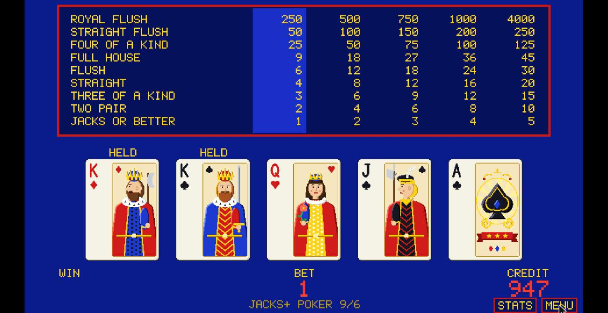
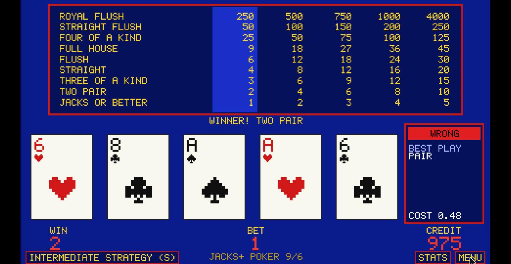
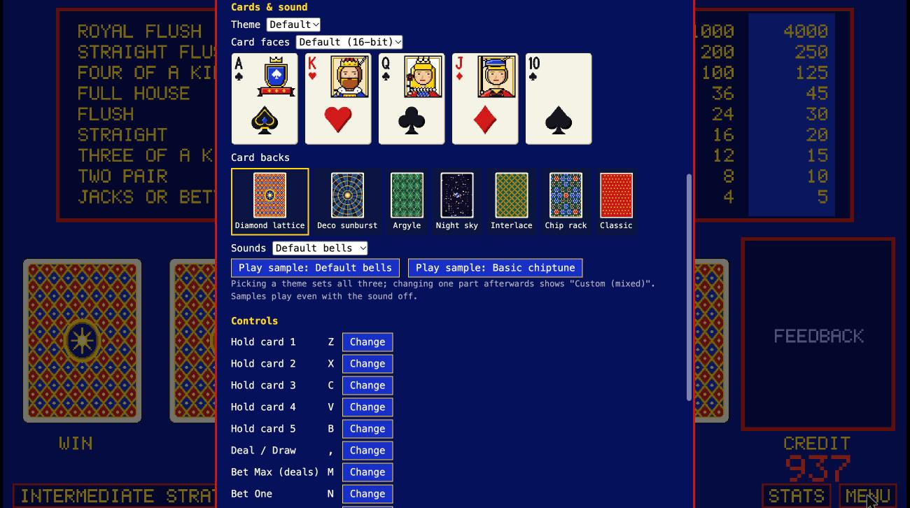
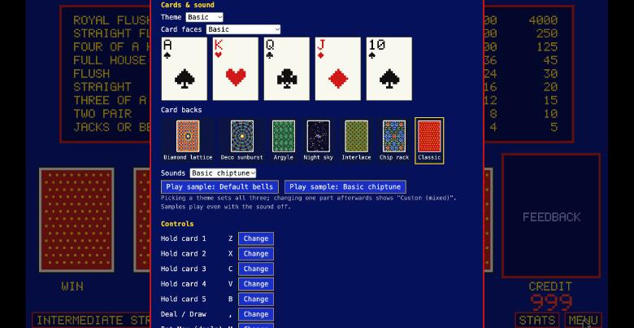
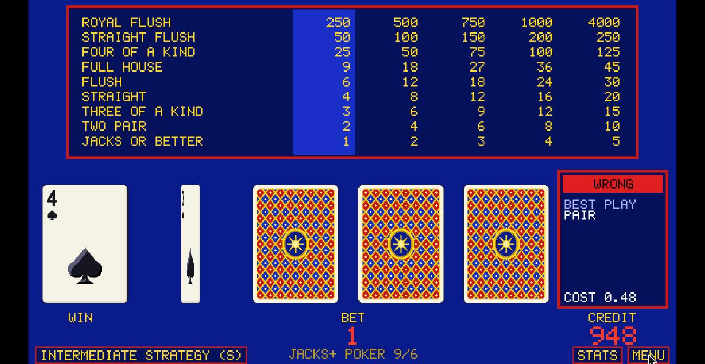
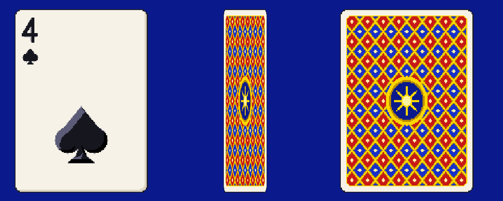
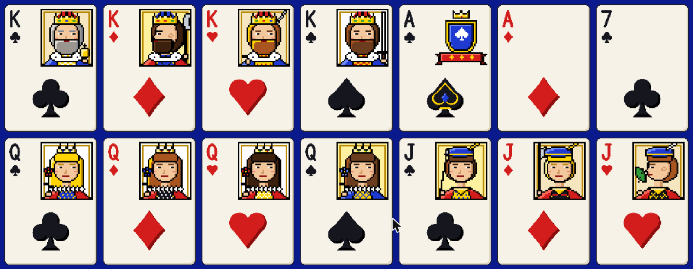

# Progress

## Milestone 1 — Engine core (2026-11-21)

### Built
- **Repo and tooling.** `engine/` Rust crate (library, `ovp` CLI, wasm bindings
  via wasm-bindgen), `app/` Vite + TypeScript shell with the engine in a Web
  Worker, vitest, MIT license.
- **Data-driven games.** Game definitions (deck + ordered pay lines with rank /
  quad / kicker conditions) and pay tables (per-coin pays, max-bet overrides)
  are JSON in `data/`. Only 9/6 Jacks or Better ships so far (M2 adds the rest).
- **Hand evaluator** for natural five-card hands, on full or reduced decks.
- **Exact 32-hold EV.** For every deck subset of ≤4 cards the engine
  precomputes how many five-card hands contain it in each pay category; a
  hold's outcome counts then follow by inclusion–exclusion over the dealt hand
  (32 lookups + a Möbius transform). Everything is integer-exact; the tables
  don't depend on pay amounts, so bet size changes need no rebuild.
- **Full-game analysis** over the 134,459 suit-permutation classes, with
  returns as exact fractions, the optimal hold for every class, the outcome
  distribution, and the exact return of any (suit-symmetric) hold policy.
- **CLI:** `ovp analyze`, `ovp holds "<hand>"`, `ovp verify [--full]`, `ovp list`.

### Verified (SPEC §3.3) — all pass
| Check | How |
|---|---|
| Fast path = brute force | Every category count of all 32 holds identical to direct enumeration of every draw; 64 random hands in `cargo test`, 500 via `ovp verify`. |
| Probabilities sum to 1 | For all 134,459 classes × 32 holds, counts are ≥0 and sum to the number of draws; full-game outcome probabilities sum to exactly 1; class weights sum to C(52,5). |
| Suit-permutation invariance | 5,000 (test) / 25,000 (CLI) random hands with random suit relabelling give identical results. |
| Symmetry = no symmetry | Exact equality of optimal return, and of a sample strategy's return, on three reduced decks (20, 21 with 3 suits, 28 cards) and on the full 52-card deck. On the two smallest decks also equal to a fully brute-force computation that uses no tables. |
| Evaluator | Category totals over all 2,598,960 hands match the combinatorial counts. |
| Class count | Exactly 134,459 suit classes. |

**9/6 Jacks or Better, max bet:** optimal return **99.543904%**
(exact 1653526326983 / 1661102543100). Informational cross-check: matches the
commonly published 99.54%.

### Performance (Apple M4)
| | Native | WebAssembly (Node/V8) |
|---|---|---|
| Draw tables (once per game) | 118 ms, 3.2 MB | 230 ms |
| Full-game analysis | 103 ms | 199 ms |
| 32-hold EV, one hand | 0.8 µs | 1.6 µs (target: <10 ms) |

`cargo test`: ~14 s for the verification suite. `ovp verify --full`: ~34 s
(mostly the 500-hand brute-force comparison).

### Notes / open questions
- Exactly tied holds: the owner decided (after review) that they are
  equivalent choices; SPEC §3.1 updated. The engine still reports one
  representative best hold ("lowest mask"); M3 will expose the full tie set.
- Multi-hand deals and carried state (Ultimate X etc.) are not modelled yet:
  the engine API is per-hand and stateless, so the game model added in M2/M4
  can wrap it. Wild cards and jokers will need evaluator extensions (v1.x).
- Dev-only dependency note: Vite pulls in `lightningcss` (MPL-2.0) as a build
  tool; it is not shipped. All shipped/engine dependencies are MIT/Apache.
- Browser shell: confirmed working in a browser by the owner (EV table shows).

### For playtesting
Nothing yet (no game UI until M4).

## Milestone 2 — Game definitions (2026-11-21)

### Built
- **Four games as data:** Jacks or Better, Bonus Poker, Double Bonus, Double
  Double Bonus (`data/games/`). Generic default labels: "Jacks+ Poker",
  "Bonus", "Double Bonus", "Double Double Bonus". DDB's kicker quads are
  pay-line conditions (`quad_ranks`, `kicker_ranks`), not code branches.
- **Preset library, 20 pay tables** (`data/paytables/<game>.json`, one line
  per table): JoB 9/6 9/5 8/6 8/5 7/5 6/5; BP 8/5 7/5 6/5; DB 10/7 9/7 9/6 9/5
  9/6/4 9/5/4; DDB 9/6 9/5 8/5 7/5 6/5. `build.rs` registers every data file,
  so a new preset needs no code.
- **Bet size 1–5:** per-coin pays × bet; the royal is 250/coin below max bet
  and 4000 at max bet (`max_bet_pays`).
- **Progressive royal:** optional amount in whole credits; replaces the
  game's `progressive_line` at max bet only, and is ignored below max bet.
- **Custom tables:** engine validates any JSON table (every line paid once,
  no unknown lines, non-negative, right game). CLI: `--paytable-file`,
  `--set line=N`, `--set max:line=N`. Browser: custom variants saved in
  localStorage (`app/src/customTables.ts`); switching tables within a game
  reuses the draw tables (~0 ms, no rebuild).
- **CLI:** `ovp list`, `ovp analyze --all`, `--bet`, `--progressive`,
  `ovp verify --all`.
- Dev shell in the browser: preset/custom table picker, bet, progressive,
  editable pays with "Save custom".

### Verified — all pass (`cargo test`: 46 tests; vitest: 11; `ovp verify --all`: 49 checks)
- The whole §3.3 suite now runs for **every game**: fast path vs brute force,
  probabilities, suit invariance, and symmetry vs every deal on four reduced
  decks. A new 20-card deck (A,2,3,4,5 × 4 suits) makes ace and low quads
  with every kicker reachable, and it is checked against fully brute-force
  play with no tables.
- Pay-line unit tests for every bonus quad and DDB kicker combination.
- **Bet size (all 20 presets):** returns at bets 1–4 are exactly equal; max
  bet is higher (the 4000 royal).
- **Progressive (all 20 presets):** an amount equal to the base royal changes
  nothing. It's ignored below max bet. Raising it by Δ with the old holds
  kept raises the return by exactly P(royal)·Δ/bet (exact fractions). With
  re-optimised holds the return rises further, and the royal gets no less
  frequent. A test shows the optimal hold flipping (JJ → 3 to a royal) under
  a big progressive at max bet but not at bet 4.
- Custom table equal to a preset gives exactly the preset's return.
- Example, 9/6 JoB: bet 4 → 98.373457%, bet 5 → 99.543904%,
  progressive 6000 → 100.651332%, 8000 → 101.863527%.

### Results (max bet, optimal play)
| Table | Return | Published (info) |
|---|---|---|
| JoB 9/6 · 9/5 · 8/6 · 8/5 · 7/5 · 6/5 | 99.5439 · 98.4498 · 98.3927 · 97.2984 · 96.1472 · 94.9961 | all match |
| BP 8/5 · 7/5 · 6/5 | 99.1660 · 98.0147 · 96.8687 | all match |
| DB 10/7 · 9/7 · 9/6 · 9/5 · 9/6/4 · 9/5/4 | 100.1725 · 99.1065 · 97.8062 · 96.7264 · 96.3754 · 95.2738 | match where known (9/5: none on file) |
| DDB 9/6 · 9/5 · 8/5 · 7/5 · 6/5 | 98.9808 · 97.8729 · 96.7861 · 95.7120 · 94.6569 | match where known |

Investigation note: three of my first "published" figures came from memory
and didn't match (DB 9/6, DB 9/5, JoB 6/5). Checking sources showed the
96.38% I had for DB 9/5 belongs to the 9/6/4 table (straight pays 4). The
engine reproduces that and 9/5/4 (95.27%), so I fixed the data, added both
as presets, and now store only sourced figures at the precision given.

### Performance (native, M4)
Draw tables 90–120 ms per game; full analysis ~105–117 ms per table; all 20
presets in 2.3 s. wasm bundle 271 kB (98 kB gzip).

### Open questions / notes
- Progressive amounts are whole credits (keeps the math exact). If the UI
  wants dollars/cents with fractional credits, I'll scale internally.
- SPEC §3.1 says presets ship with precomputed results. Full analysis takes
  ~0.2 s in wasm, so for now nothing is precomputed for returns. Generated
  strategies (M3) will ship as files.
- Browser: dev server, assets and production build checked. The Chrome
  extension tools were not available in this session, so I haven't eyeballed
  the M2 shell controls in a real browser.

### For playtesting
Nothing yet (no game UI until M4).

**Update (M2 review, 2026-11-21):** owner confirmed progressive amounts stay
whole credits and nothing is precomputed for now. M2 shell checked in Chrome:
DDB 9/6 → 98.9808%; a custom DDB 8/5 saved in the page gives 96.7861%
(= preset), persists across reload; no console errors.

## Milestone 3 — Strategy layer (2026-11-21)

### Built
- **Rule language** (plain text, one rule per line; see
  [strategy-format.md](strategy-format.md)). It covers:
  - pat hands, including several on one line;
  - quads, trips and pairs by rank group, with DDB kickers;
  - draw families (royal / straight flush / flush / straight) with
    `w` (straights the cards fit) and `h` (high cards);
  - exact combinations ("QJ suited", "KQJ unsuited", "K");
  - "N high cards";
  - penalty qualifiers `fp` (flush) and `sp` (straight), and `prefer low`.
  Tie-break inside a rule: highest ranks, then fewest fp, then fewest sp.
- **Evaluator** (exact). It reports the return, the EV loss (credits/hand and
  points of return), per-rule fires / wrong / loss, undefined and ambiguous
  hands, and the costliest misplays.
- **Completeness checker:** every one of the 134,459 classes must resolve,
  with no ambiguity.
- **Generator** for all three tiers, run natively from the CLI and in the
  browser worker (wasm). It builds candidate rules from the game and the
  analysis, records what each rule would cost on every class, then searches.
  The search is greedy plus backward elimination from 10 starting points,
  with local moves, swaps, compound moves and "family bursts". Tiers are
  warm-started from the tier below and never worse than it.
- **60 shipped strategies** in `strategies/<paytable>/<tier>.txt` (20 presets
  × 3 tiers), with numbers in comments. CLI: `ovp strategy
  generate|eval|play|tidy`. Dev shell: strategy panel (preset or generate,
  per-rule table, deciding rule for a hand).

### Decisions made (owner asked for intelligent choices here)
- **Exact ties** (SPEC updated): no EV loss is charged for a hold exactly
  tied with the best one. Leftover choices within a rule that are exactly
  tied aren't ambiguous. In checking modes a tied hold counts as the same play.
- **Groups are counted as dealt:** "pair" is a rank dealt exactly twice. The
  first generator broke quads into "three of a kind"; this rule makes that
  impossible.
- **Every pat hand has a line in every tier**, so no strategy breaks a dealt
  royal for lack of a line. Several pat hands may share one line, which is
  what makes a 15-line beginner tier usable. The generator still decides
  where they go (4 to a royal over a pat flush, AAA+kicker over a full house
  in DDB).
- **Tier qualifiers:** beginner none; intermediate `fp` only; expert `fp` and
  `sp`. Caps 15 / 30 / 60 (defaults, in `generate.rs`).

### Verified — all pass (`cargo test`: 46 tests; vitest: 16)
- All 60 shipped strategies:
  - parse back and are complete;
  - recorded return equals a fresh exact evaluation;
  - within their tier's line cap and qualifier rules;
  - every pat hand covered;
  - beginner ≥ intermediate ≥ expert in loss.
- Class-based evaluation is exact. On four reduced decks × 2 games, playing
  the strategy on every single deal gives exactly the same return. Play is
  suit-symmetric on 20,000 random full-deck hands.
- The generator's internal loss equals the exact evaluator (to 1e-9) for
  every generated strategy. I hit one discrepancy during development
  (running-sum drift in the search), caught by this check and fixed.
- Ties: replacing every best hold with another exactly-tied hold leaves the
  exact return unchanged.
- Per-rule numbers add up to the totals. The checker flags undefined hands.
  `tidy` changes no play (checked on all 60 files).
- wasm: preset strategies evaluate to their recorded return; generation of
  all three tiers works in wasm (small custom deck in tests; full deck
  benchmarked below).

### Results (return %, max bet; loss vs optimal in credits/hand)
| Table | Optimal | Beginner (15) | Intermediate (30) | Expert (≤60) |
|---|---|---|---|---|
| JoB 9/6 | 99.5439 | 99.3292 (0.0107) | 99.5421 (0.00009) | 99.5436 (0.00001) |
| JoB 8/5 | 97.2984 | 97.0641 (0.0117) | 97.2939 (0.0002) | 97.2981 (0.00002) |
| BP 8/5 | 99.1660 | 98.8751 (0.0145) | 99.1620 (0.0002) | 99.1657 (0.00001) |
| DB 10/7 | 100.1725 | 99.6485 (0.0262) | 100.0813 (0.0046) | 100.1715 (0.00005) |
| DB 9/6 | 97.8062 | 97.3618 (0.0222) | 97.7544 (0.0026) | 97.7972 (0.00045) |
| DDB 9/6 | 98.9808 | 98.2990 (0.0341) | 98.9428 (0.0019) | 98.9796 (0.00006) |
| DDB 6/5 | 94.6569 | 94.0135 (0.0322) | 94.6106 (0.0023) | 94.6563 (0.00003) |

All 60 are in the file headers. Bonus games lose more at the beginner tier:
15 lines can't express their rank-dependent quads/trips play.

### Performance
- Generation (native, 10 search starts in parallel on 10 cores): ~3–7 s
  beginner, 7–15 s intermediate, 37–78 s expert per table; all 60 in ~20 min.
- WebAssembly (single thread, full deck, 9/6 JoB, older 5-start build):
  13 s beginner, 49 s intermediate, 156 s expert. The current 10-start
  search will take roughly twice that, about 7 minutes for all three tiers
  of a custom table.
- Exact evaluation of a strategy: ~0.5 s native, ~1.5 s wasm.

### Open questions
- **Custom-table generation time in the browser** (~7 min for all tiers). A
  "quick" mode with fewer search starts is easy if that's too slow. Worth
  deciding before M5/M6.
- **Tier caps** (SPEC open question): 15 lines costs bonus games 0.02–0.04
  credits/hand at beginner. Raising beginner to ~20 would help those games
  most.
- Expert DB 9/6, 9/5, 9/6/4 still lose 0.0001–0.0005 credits/hand. Other
  tables get to ~0.00002, so there is search headroom left there.
- Penalty qualifiers rarely win a line at the intermediate tier; the
  language may need finer qualifiers for experts later.

### For playtesting
- Whether the strategies read naturally (`w=`/`h=` notation; `prefer low`
  on "2 high cards" means "keep the two lowest", e.g. KQ from AKQ).

**M3 review (2026-11-21).** Owner decisions: ~7 min browser generation is
acceptable (rare event); expert weak spots accepted for now; keep the
shipped 15-line beginner strategies.
- **Tunable line cap** for custom strategies: `ovp strategy generate ...
  --max-lines N`, `maxLines` in the wasm/worker API, "Line cap" field in the
  dev shell (3–200). Example: DDB 8/5 beginner at 20 lines loses 0.0118
  credits/hand vs 0.0354 at 15.
- **Reading order fix.** Owner reported DDB 8/5 beginner listing "pair J-A"
  above "three of a kind", which reads as "break trip aces". Play was already
  right: "pair" means a rank dealt exactly twice, so trips are never broken.
  But the order of rules that never compete was arbitrary. A new pass sorts
  those rules by the average EV of their holds, moving one only past
  neighbours that never decide the same hands, so play can't change. Applied
  to all 60 shipped files with play verified unchanged (same holds, same
  exact return). Now trips read right under the pat hands. New tests cover
  the line cap and reading order (Rust 48 tests, vitest 16).

## Milestone 4 — Playable game (2026-11-21)

### Built
- **Cabinet screen** (`app/index.html`). An older-bartop look: deep blue
  field, yellow pay table in a red frame, current bet column highlighted,
  winning line lit (on the deal, and flashing after a win), HELD labels, red
  WIN / BET / CREDIT meters, game label.
  - All art is drawn in code: an original 5×7 pixel font, 9×9 suits, card
    faces and backs. Nothing is copied.
  - Rendered on a 480×270 pixel grid. Every pixel edge is rounded to device
    pixels, so it's crisp at any window size or full screen (16:9,
    letterboxed).
- **Free Play.** Deal/draw, holds, Bet One (cycles 1–5), Bet Max (deals),
  royal 250/coin below max bet and 4000 at max, optional progressive.
  Credits are play credits, auto-refilled to 1000 when they run out, and
  there's a reset in the menu. Credits and bet persist across reloads.
- **Game model** (`app/src/game/model.ts`). A pure state machine: an action
  returns the new state plus events, at once. Hands are a list and there's a
  `carry` slot for state between deals (multi-play / Ultimate X later; not
  implemented). Hand evaluation and pays come from the wasm engine via a
  lightweight `Rules` class with no lookup tables, so it's cheap on the UI
  thread.
- **Input layer.** Buttons go to actions. The keyboard source uses the
  default keymap in `app/src/config/keymap.ts` (Z X C V B, comma, M, N), and
  key-repeat and modifier keys are ignored. A pointer source (click a card to
  hold it) shows the layer works for other inputs; GPIO can plug in the same
  way later.
- **Animation and sound never gate input.** State changes on the key press;
  the card-flip and count-up timeline only affects what's drawn, and the
  next action skips it. Sound: synthesized Web Audio (deal, hold, bet, draw,
  win, count-up, buzz on a rejected press), muted by default.
- **Menu** (mouse). Game and pay table (presets and saved custom tables),
  game label rename, progressive, speed slider (slow → instant, default
  fast), sound on/off and volume, key remapping with conflict warning and
  reset, credits reset, full screen.
- The M1–M3 engine shell moved to `app/dev.html`.

### Verified
- **Acceptance (Chrome, real key events):** 40 hands at 0.78 s/hand, every
  press applied. Key handler 0.2 ms median / 0.8 ms max; key press to
  visible frame 16 ms median / 18.5 ms max (the next display frame); no
  frame over 50 ms. With sound on: 30 hands, ≤ 19.5 ms, no errors. At the
  slowest speed, 10 deal-hold-draw bursts sent with no gap were all applied
  at once.
- **vitest (31 tests, +15 for M4):**
  - deal / hold / draw order;
  - payouts match the engine's pay table and credits balance exactly over
    5,000 seeded hands (with random holds);
  - Bet One cycling, Bet Max deals, refill, rejected presses;
  - an action costs < 0.2 ms;
  - keymap matches the spec with no conflicts; keyboard source ignores
    repeats, modifiers and unknown keys, and is off while the menu is open;
  - the animation timeline never holds back the meters; a full hand
    including a royal count-up fits in 2 s at the default speed;
  - every pay line name of every game is drawable in the font and fits the
    column;
  - prefs round-trip and survive garbage or blocked storage.
- Rust: 48 tests still pass. Production build OK (game + dev shell).

### Performance
Model action < 0.2 ms; frame draw well under one 60 Hz frame (no long
frames observed). Game bundle 32 kB JS (11.5 kB gzip) + 271 kB wasm.

### Open questions
- Win line flashes until the next deal (like real machines); should it stop
  after a few seconds?
- The pay table is dense for Double Double Bonus (13 lines; rows are 8 px
  on the 270 px grid). Readable, but it's the tightest part of the screen.

### For playtesting (all in `config/feel.ts` or `config/keymap.ts`)
- Speed levels: ms per card reveal/flip, count-up rate and caps (fast:
  30 ms/card, 25 ms flip, 1200 credits/s, ≤ 1.2 s).
- Colors (`PALETTE`) and layout (`LAYOUT`), card art, font.
- Sound effects (pitches/lengths in `audio/sfx.ts`), default volume 0.35.
- Bet One on `N` (still provisional); clicking a card holds it.
- Auto-refill at 0 credits (`AUTO_REFILL`), starting credits 1000.

### M4 review
- Owner kept the endless win flash and the dense DDB pay table as is.
- Added a dealt-win chime: a short rising two-note cue (`Sfx.dealtWin`) when the dealt hand already pays, timed to the last card reveal. Verified in Chrome: it fired on exactly the 37 paying deals out of 200, with no errors.

## Milestone 5: Trainer

### What was built
- **Engine** (`strategy/trainer.rs`, wasm `setTrainerStrategy` / `dealCheck`):
  for each dealt hand, one call returns everything needed to judge any
  hold: exact EVs, exact-tie groups, the strategy's rule and hold, the rules
  that match the hand (in order), and the **rule distance** of all 32 holds.
  - Distance = position, in the per-hand list of matching rules, of the
    first rule that describes the player's hold exactly (SPEC §5.3).
  - A hold tied in EV with the strategy's is distance 0 (the same play).
  - No rule describes the hold: off-strategy.
  - Decision: the deciding rule's pattern but the wrong cards (e.g. KQ
    where the rule picks QJ) counts as distance 1: right rule, wrong cards.
- **Checking modes** (`trainer/grade.ts`):
  - Strategy (default): right iff the same play as the strategy.
  - Pure EV: right iff within the grace margin of the best hold. The margin
    is 0.05 credits at max bet, scaled by bet/max bet, and adjustable.
  - Without a preset strategy (custom pay tables), checking falls back to
    Pure EV and rule stats are off.
- **Modes** (`trainer/trainer.ts`):
  - **Lesson:** a wrong hold blocks the draw with a buzz.
    1. First mistake: "try again".
    2. Second mistake: the rule's name. If no rule describes the right
       play (Pure EV), it skips straight to step 3.
    3. Third mistake: green frames around the cards to hold, which must
       then be entered.
  - **Practice:** a permanent feedback box right of the cards; the cards
    shift left to make room.
    - The box shows CORRECT (green), CLOSE (yellow, distance 1), or
      WRONG / OFF STRATEGY (red).
    - It also shows the best play's rule and the credits it cost.
    - In Pure EV mode, a wrong play that still follows the strategy is
      yellow.
  - **Free Play:** no feedback.
  - Every mode records stats. In Lesson, stats judge the **first** hold
    tried.
- **Stats** (`trainer/stats.ts`, `store.ts`, `ui/statsView.ts`; STATS
  button). Session and lifetime are shown side by side, each with its own
  reset (two clicks).
  - Hands, credits bet and won, and actual return.
  - EV loss (1) vs optimal, (2) vs strategy, and (3) the strategy's own
    loss, in credits: totals and per hand. Metric (4) is still open
    (SPEC §5.4).
  - Deviations from the strategy.
  - Distance histogram (0, 1, 2, 3, 4+, off).
  - Results by pay line.
  - Misses, chances and miss rate per rule for the current strategy.
- **Persistence and settings:**
  - Stats are saved in IndexedDB, batched every 250 ms and on page hide.
    Session stats persist across reloads until you reset them.
  - The menu's Trainer section sets the mode, checking mode, strategy tier
    and grace margin. These are saved in prefs.
- **Engine worker:** the game page now has the engine worker for these
  checks. A check is asked for at deal time and normally arrives before
  Draw. If the player draws first, Lesson waits for it (queued);
  Practice and Free Play never wait.

- **Strategy tag and view** (owner request after review):
  - In Practice and Lesson, a framed tag at bottom left shows the level,
    e.g. "BEGINNER STRATEGY (S)".
  - Clicking it, or pressing S, opens the strategy view, drawn on the
    cabinet screen in the game's font and colors.
  - The view has tabs to switch level (click, or ←/→), the strategy's
    return and loss, and the numbered rules in plain words.
  - Scroll with the wheel, ↑/↓, PgUp/PgDn or Home/End. Close with S, Esc
    or CLOSE.
  - Play keys are ignored while the view is open.
  - "Strategy view" is a new button in the input layer, remappable in the
    menu. A saved keymap from before it existed keeps its remaps and gets
    S for the new button.

### Verification
- Rust (52 tests pass):
  - The distance cases above, written by hand.
  - EV ties checked against the exact comparison.
  - Invariants on 3,000 random hands.
  - On 300 hands for each of the 60 shipped strategies, the deal check
    agrees with play.
- Vitest (52 tests pass; the list below predates the strategy view, whose
  tests cover rows, scrolling, tabs, clicks and keymap migration):
  - Green, yellow and red grading.
  - Pure EV grace and its bet scaling.
  - Fallback when there's no strategy.
  - The Lesson sequence: wait, block, rule, marked cards, then the
    entered hold.
  - Practice with a late check; Free Play.
  - The game app's blocked and queued draws.
  - Stats sums, including (1) = (2) + (3).
  - Save, reload, reset, and malformed saved data.
  - Prefs.
- Checked in Chrome:
  - The Practice box and the Lesson hint frames.
  - Stats survived a page reload and the stats screen rendered.
  - I cleared my test hands afterwards.

### Performance (Chrome)
- Engine check per deal: 4.6 ms median, 5.7 ms max, round trip to the
  worker.
- Key handler: 0.4 ms median, 3 ms max.
- Input to frame: 2 ms median, 16 ms max.

### Open questions
- Stats metric (4) (SPEC §5.4), still undefined.
- "Right rule, wrong cards" counts as distance 1 (yellow). Should it be
  red instead?

### For playtesting (`config/trainer.ts`, `config/feel.ts`)
- Defaults: Practice mode, Strategy checking, the Intermediate strategy,
  and a 0.05 grace margin.
- Feedback box size and position (`LAYOUT.feedback`, `practiceCardsX`),
  its colors, and wording (CORRECT / CLOSE / WRONG / OFF STRATEGY).
- Lesson messages (`LESSON_TEXT`) and the green hint frame.
- Rule names are shown in plain words (e.g. "4 to an outside straight";
  table in `docs/strategy-format.md`). Files keep the exact notation.
- Session stats last until you reset them; they are not reset by time.
- Strategy tag position and wording, the view's layout (`LAYOUT.strategyTag`,
  `LAYOUT.strategyView`), and the S key. The view opens only in Practice and
  Lesson, not Free Play.

## Milestone 6: itch.io alpha build

Moved ahead of the strategy editor at the owner's request (SPEC §8 updated:
the editor and comparison screen are now Milestone 7).

### What was built
- `npm run build:itch` (in `app/`) runs, in order:
  1. rebuild the wasm;
  2. type-check;
  3. run the app tests;
  4. build the game page only, without the engine dev shell, into
     `app/dist-itch`;
  5. pack the zip with `index.html` at its root:
     `release/open-video-poker-trainer-0.1.0-html5.zip` (65 files,
     825 kB unpacked, 257 kB zipped).
- `app/scripts/pack-itch.mjs` refuses to pack if any of these fail:
  - `index.html` is at the root and no dev page is included;
  - all paths are relative and a `.wasm` file is present;
  - the build is within itch.io's 1,000-file and 200 MB limits.
- **STATS and MENU moved onto the canvas** as framed buttons at bottom
  right, in the same style as the strategy tag.
  - Why: at itch.io's exact 16:9 embed there is no letterboxing, so the old
    HTML buttons covered the pay table's 5-coin column.
  - The bottom row moved down 1 px to clear the credit meter.
  - The strategy view now covers the whole screen.
- Clicking the game gives the iframe keyboard focus.
- The menu shows the version, the MIT license and the "not a gambling
  product" note.
- `docs/itch.md` has upload steps, embed settings (960×540, fullscreen
  button on, not mobile, free with no donations) and suggested page text.
- Screenshots are in `release/screenshots/`. Like the zip, they are not
  committed.

### Verification
- The release zip was unpacked into `/html/<id>/` on one origin and
  embedded in an iframe from a different origin, as itch.io does:
  - no console errors;
  - the canvas STATS and MENU buttons work;
  - settings persisted across reloads inside the iframe.
- The release build opened directly: keys play, the trainer feedback
  works, and IndexedDB stats persisted across reloads.
- The browser automation tool couldn't send key presses into the
  cross-origin iframe. Keys inside a real itch.io embed should be checked by
  hand after upload.
- Tests: 52 app tests, 52 Rust tests, all passing.

### Open questions
- Should a "Practice" yellow lamp say CLOSE? Next to the CLOSE button in the
  strategy view the word does double duty; "NEAR MISS" or "1 RULE OFF" are
  options.

### For playtesting
- Keys inside the real itch.io embed (click the game first).
- Embed size 960×540 vs. larger; fullscreen.
- The bottom-right STATS/MENU buttons.

## Milestone 7: Strategy editor and pay table comparison

### What was built
- **Strategy editor** (Menu > Strategy editor), for the current pay table:
  - reorder rules by dragging or with ▲▼; add, remove and edit rules in file
    notation, with suggestions drawn from every preset rule of the game;
  - "discard everything" is pinned as the last line;
  - bad lines and repeated rules are flagged on the line itself;
  - after every change the exact evaluator reruns and shows the return, the
    EV loss in credits per hand, the change from the last edit and since
    loading, completeness (ambiguous hands, with examples), each rule's
    numbers, and the 10 costliest misplays;
  - undo, plus load any level, generate (with cancel), import, and export;
  - an unsaved-changes prompt on close.
- **"My strategy"**: saving stores one strategy of your own per pay table
  (locally), in the strategy file format with exact numbers in its header.
  It is a fourth trainer level: in the menu, as a tab in the on-screen
  strategy view, and in the tag ("MY STRATEGY (S)"). "Save and train with it"
  selects it.
- **Compare pay tables** (Menu): pick table A and B and a level for each.
  The defaults are A = the game's full-pay preset and B = the current
  table. The screen shows:
  - optimal, B's strategy and A's strategy, all played on B;
  - each rule added, removed or moved, with its EV effect on B;
  - the hands played differently, grouped by deciding rule, with an
    example hand;
  - both lists, with the changes marked.
  How the effects are defined is in `docs/strategy-format.md`; they add up
  exactly to the total.
- CLI: `ovp strategy compare A.txt B.txt -p TABLE_B`.
- Both screens use a second engine worker, so a long evaluation or a
  generation never delays the trainer's checks.

### Verified
- Rust (57 tests, 5 new):
  - edit steps always turn A into B, and every intermediate list is a
    valid strategy (500 random pairs, both directions);
  - on full-deck presets, the endpoints equal the exact evaluator's results,
    and the change effects and the group effects each add up to the total
    within 1e-12;
  - on reduced decks, each change's effect equals the difference of the two
    lists played on every single deal;
  - splitting pat lines leaves play identical.
- App (64 tests, 12 new): the editor model, live evaluation (only the
  latest request reports), a saved strategy's header matching a fresh exact
  evaluation, the comparison through the worker handler, the defaults, and
  the level persisting in prefs.
- In Chrome on the dev build:
  - the editor matches the shipped numbers;
  - edits update live;
  - undo works;
  - "Save and train" switches the tag and adds the tab;
  - the comparison renders;
  - generation can be cancelled and evaluation recovers afterwards;
  - beginner generation finished in 11 s and matched the shipped list;
  - no console errors.
- The itch.io release zip builds (65 files, 281 kB).

### Performance (wasm, in the browser)
- Re-evaluation after an edit: ~0.6 s. Evaluation now computes draw counts
  once per class, about 25% faster than before.
- Comparison: ~1.5 s, including loading the second table's game.

### Regenerated with sibling seeding (owner approved)
The comparison showed that 10 of the 60 shipped strategies were beaten on
their own table by another table's list at the same level (for example BP
7/5 intermediate lost 0.00155 credits/hand where BP 8/5's list lost
0.00021). The fix:
- **Generator:** `generate` takes any number of seed lists. Their rules join
  the candidate library if the tier allows them, and the search also starts
  from each one, so the result is never worse than a seed that fits.
- **`ovp strategy generate --all`:** each table and level is seeded from the
  level below and from every other preset table of the game at that level.
  Afterwards a check pass regenerates any list that a sibling or its own
  lower level still beats, until none is. On this run that pass found
  nothing to fix.
- **Results:** none of the 60 got worse and 29 improved, more than the 10
  flagged, because improvements carried from table to table. The table
  below shows some of them. Other notable gains: DB 9/6 expert, 0.00045 →
  0.000035 (the M3 weak spot), DB 9/5 expert 0.00021 → 0.000051, and
  JoB 9/6 and 8/6 expert 0.000013 → 0.000001.

| Table, level | Loss before | Loss after |
|---|---|---|
| BP 7/5 intermediate | 0.001552 | 0.000209 |
| BP 6/5 intermediate | 0.001639 | 0.000484 |
| BP 8/5 beginner | 0.014543 | 0.011755 |
| DB 10/7 intermediate | 0.004559 | 0.001711 |
| DB 9/6 intermediate | 0.002593 | 0.001532 |
| DB 9/5 intermediate | 0.002142 | 0.000783 |
| JoB 9/5, 8/5, 7/5, 6/5 intermediate | 0.00022–0.00026 | 0.000041–0.000058 |
| DDB 9/5 / 8/5 intermediate | 0.00170 / 0.00181 | 0.00126 / 0.00135 |

- **Generation time:** a full `--all` run now takes about 41 minutes (was
  ~20). The browser generator is unchanged: a single seed, same speed.
- **New tests:** for every game, no shipped list is beaten on its own table
  by a sibling's list at the same level (these tests failed on the old
  files). A seed bounds the result even when its rules aren't in the
  candidate library, and rules the tier doesn't allow are ignored.
  Rust: 62 tests in total.

### Open questions
- In the browser editor, "Generate" for a custom table could also seed from
  the game's preset lists at that level. That would give better lists, but
  roughly doubles the time in the browser. It is not done yet.
- Rule changes are matched by exact text. A reworded rule (e.g. a different
  qualifier) shows as a removal plus an addition whose effects mostly
  cancel. The "hands played differently" table is the clearer view of what
  actually changes.

### For playtesting
- Editor layout and density, drag-and-drop feel, the suggestion list.
- Whether the compare screen's two views (rule changes, hands played
  differently) read well; which one should come first.
- Naming: "My strategy" (menu) / "MY STRATEGY" (tag and tab).

## Strategy compaction and new tier caps (owner request, 2026-11-24)

### What changed
- **Merged lines.** Adjacent rules that no hand reaching them matches
  together are written on one line, comma-separated (`full house, 4 to a
  royal`, `flush, straight, three of a kind`), and count as one line
  toward the cap. Play never depends on the grouping: rules are still
  tried in written order. The generator's fit loop counts merged lines;
  when merging frees lines, it raises its rule cap and fills them with the
  best remaining candidates.
- **Dead-rule pruning.** A rule worth less than 1e-7 credits/hand
  (`DEAD_RULE`) is dropped and never added, and its line goes to the next
  best candidate. That's why most Expert lists stop well short of 40.
- **Full house guardrail.** A dealt full house is never broken unless that
  is an optimal play. Owner's decision: in DB/DDB, `three of a kind A` may
  still sit above `full house` (breaking aces full is optimal there; forcing
  it below cost DB 9/6 expert 0.000035 → 0.000619). General trips and pair
  rules never sit above it. The old DDB beginner lists broke every full
  house this way.
- **Caps:** Beginner 20, Intermediate 25, Expert 40 lines (were 15/30/60).
- **Trainer:** rule distance counts lines (a merged line is one step). The
  feedback box, lesson hint and stats name the single rule that applied.
  The strategy screen joins a line's rules with " / " (the pixel font has
  no semicolon).
- **Editor:** a line may hold several rules. The suggestion list and
  compare screen work as before; compare splits merged lines first.

### Results (loss, credits/hand at max bet; lines before → after)
| Table, level | Before | After |
|---|---|---|
| JoB 9/6 beginner | 0.010737 (15) | 0.001015 (20) |
| JoB 9/6 intermediate | 0.000062 (30) | 0.000025 (24) |
| JoB 9/6 expert | 0.000001 (59) | 0.000001 (29) |
| BP 8/5 beginner | 0.011755 (15) | 0.000705 (20) |
| DB 9/6 beginner | 0.022223 (15) | 0.004269 (20) |
| DB 9/6 expert | 0.000035 (60) | 0.000035 (36) |
| DDB 9/6 beginner | 0.034087 (15) | 0.004066 (20) |
| DDB 9/6 intermediate | 0.001717 (30) | 0.000773 (25) |

All 60 lists: beginner losses fell 5–15×; intermediate equal or better
except DB 9/6/4 (0.001036 → 0.001199, 30 → 24 lines); expert lists are
29–40 lines (were 56–60) with equal loss, except DB 9/6/4 expert (0.000061 →
0.000082 at 33 lines) and DB 9/7, DB 10/7 (slightly better).

### Verified
- New tests: every shipped list respects its line cap; no hand reaching a
  merged line matches two of its rules; no dealt full house is broken
  unless optimal; merged and one-rule-per-line lists play every hand the
  same; JoB 9/6 lists have no rule worth under 1e-7; merged lines round-
  trip through text. Existing sibling/tier/seed tests pass unchanged.
- Rust: all suites pass. App: 64 tests pass (expectations updated where
  the JoB 9/6 beginner list itself changed, e.g. `pair` is now `pair 2-T`).
- Checked in Chrome: strategy screen (beginner, expert), a dealt hand's
  feedback, no console errors.
- Full `generate --all`: about 2 h 40 min (was ~41 min). The fit loop
  re-runs the local search several times per list.

### Open questions
- Some expert lines get long (JoB 9/6 expert line 12 holds five
  3-to-a-straight-flush variants). A per-line rule limit is easy to add if
  that reads badly.
- Generating in the browser editor is slower for the same reason as above.

### For playtesting
- The " / " separator on the strategy screen; long merged lines on Expert.

## Milestone A: strategy simplification pass (owner request, 2026-11-27)

### What was built
- `engine/src/strategy/simplify.rs`: `simplify(an, strategy)`. It builds
  one table of how every hand class meets every rule of the list, and every
  version of each rule with qualifiers left out. Then it repeats until
  nothing changes: try every one-step rewrite (drop one qualifier or all of
  them; collapse a run of siblings that differ only in one qualifier's value;
  remove a rule that a plainer copy of itself below covers, or move the
  plainer copy up), and keep the best one that plays **every class with the
  identical hold** and leaves no new tie. Best means fewest qualifiers, then
  shortest text, then fewest lines, never more lines than before. Then it
  drops duplicate rules and runs `compact`, repeating until stable.
- `generate()` calls it before its final compaction, so new generations
  come out simplified.
- `ovp strategy simplify FILE... [-p TABLE] [--renames JSON]` rewrites
  lists in place. It re-scores rather than regenerates, refuses any change
  of hold or return, and checks that the `return`/`loss` header lines are
  byte-identical.
- All 60 shipped lists rewritten. The pre-simplification lists are kept as
  test fixtures in `engine/tests/data/pre-simplify/`.
- **Per-rule stats are migrated, not reset.** `strategies/rule-renames.json`
  (written by the CLI) maps each shipped list's old rule text to the rule
  that now decides most of those hands, by deals. On load, the game adds the
  old tallies to the new rule (summing when several old rules became one)
  and saves. Custom strategies are untouched. Note: if an old rule's hands
  now split across two new rules, its whole tally goes to the one that
  decides most of them.
- `docs/strategy-format.md` has a new "Simplification" section; SPEC §4.3
  has a matching bullet. (The request said §3 for strategy notation; the
  strategy layer is §4 in SPEC.md, so that's where it went.)
- Not done (optional): a "Simplify" button in the strategy editor.

### Before → after (rule text)
| List | Before | After |
|---|---|---|
| BP 6/5 beginner | `3 to a royal h=2` / `3 to a royal, 4 to a flush h=2, 4 to a flush h=1, 4 to a flush h=0` | `3 to a royal` / `4 to a flush` |
| BP 6/5 beginner | `4 to a straight w=1 h=4`, `2 high cards suited prefer low`, `2 high cards unsuited prefer low`, `1 high card prefer low` | `4 to a straight h=4`, `2 high cards suited`, `2 high cards prefer low`, `1 high card` |
| JoB 9/6 beginner | `pair 2-T` (below `pair J-A`) | `pair` |
| JoB 9/6 beginner | `4 to a straight w=1 h=3`, `3 to a straight flush w=1 h=1`, `1 high card prefer low`, `3 to a straight flush h=0` | `4 to a straight h=3`, `3 to a straight flush h=1`, `1 high card`, `3 to a straight flush` |
| JoB 9/6 intermediate | `3 to a straight flush w=3 fp=0`, `4 to a straight w=1 h=4`, `2 high cards suited prefer low`, `3 to a straight flush w=1 h=0` | `3 to a straight flush w=3`, `4 to a straight h=4`, `2 high cards suited`, `3 to a straight flush` |
| DDB 9/6 beginner | `4 to a straight w=1 h=4`, `w=1 h=3`, `w=1 h=2`, `w=1 h=0`, `2 high cards suited prefer low` | `4 to a straight h=4`, `h=3`, `h=2`, `4 to a straight`, `2 high cards suited` |
| every list | `royal flush, straight flush, four of a kind` / `full house, 4 to a royal` | `royal flush, straight flush, four of a kind, full house` / `4 to a royal` (re-grouped by `compact`; same line count) |

Qualifiers removed, all 20 tables per tier:
| Tier | Before | After | Removed |
|---|---|---|---|
| Beginner | 312 | 214 | 98 (31%) |
| Intermediate | 586 | 384 | 202 (34%) |
| Expert | 1294 | 701 | 593 (46%) |

Lines: beginner and intermediate unchanged (400 and 492). Expert lists
went from 673 to 668 lines in total.

### Verified
- `engine/tests/simplify.rs`:
  - BP 6/5 beginner simplifies to exactly `3 to a royal` / `4 to a flush`,
    with the identical hold for every class.
  - For all 60 lists, the shipped list is exactly `simplify(original)`, with
    an identical hold for every class, identical exact return, and complete.
    Line count is ≤ the original and within the cap, qualifiers never
    increase, the merged-line invariant holds on every class, the pass is
    idempotent, and the text round-trips.
  - Regression check: every one-step rewrite still possible on a shipped
    list (drop any qualifier, collapse any sibling run, merge into a plainer
    copy below) either changes some hold, needs more lines, or leaves a tie.
    Holds are computed independently in the test, straight from the rule
    matcher.
  - The rename table only points at rules that exist in the current lists.
- All existing Rust suites pass unchanged (shipped-list checks, siblings,
  dead rules, merged lines). Engine total: 3 min 9 s on 10 cores.
- App: 67 tests pass. Three new tests cover the stats migration (merging
  tallies, custom strategies untouched, runs on load and saves, idempotent).
  JoB 9/6 beginner expectations were updated from `pair 2-T` to `pair`;
  no assertion logic changed.
- The CLI run checks that `return` and `loss` header lines are
  byte-identical for all 60 lists. A second run over the simplified lists
  changes nothing.

### Performance
- Simplify pass alone: **64.6 s for all 60 original lists** (about 1.1 s
  each, native, 10 cores); 28.9 s over the already-simplified lists. With
  loading and two exact re-scorings per list, 150 s in total.
- In the browser (custom-table generation), the pass is single-threaded,
  so expect a few seconds more per generated list.

### For the owner's decision
- **Tables with freed lines** (none refilled, as asked). All are Expert:
  DB 10/7 (39 → 38), DB 9/6 (36 → 34), DB 9/7 (40 → 39), DDB 6/5
  (34 → 33). Only DB 9/7 expert was at its 40-line cap. The others had
  already stopped short because no remaining rule was worth a line. So a
  regeneration could only help DB 9/7 expert, by at most one rule.
- **Positional wording.** `w=1` (inside straight) is also dropped where
  outside straights are already taken above, so `4 to a straight w=1 h=3`
  reads `4 to a straight h=3` (the game shows "4 to a straight, 3 high
  cards" instead of "4 to an inside straight, 3 high cards"). It plays the
  same, but "inside" is a word players know. If you'd rather keep it, I can
  make `w=` on 4-card straights exempt.
- Exact-card rules keep `suited`/`unsuited` (`KQ suited`): the parser
  requires it, and allowing a bare `KQ` would change the rule language.

### For playtesting
- Read a few simplified lists in the strategy screen. Rules are now meant
  positionally ("of the hands left at this line"); check that this reads
  naturally.

## Milestone B: skins and the new "default" theme (owner request, 2026-11-27)

### What was built
- **Skin system** (`app/src/skins/`). A skin has three independent parts:
  `faces`, `backs` and `sounds` (the `Sfx` cues). A **theme** bundles one of
  each. A registry looks parts up by id. An unknown id falls back to the
  theme's part, and an unknown theme to Default. The cabinet only calls
  `cards.face(...)` / `cards.back(...)` and never draws cards itself. Each
  skin picks its own colours (the `P.card*` entries left the cabinet
  palette).
- **Basic theme:** the old card drawing and sounds, moved out of
  `render/cabinet.ts` and `audio/sfx.ts` unchanged.
- **Default theme** (new players get it, and so do saved prefs from before
  themes):
  - Art on a 128×176 grid (half a logical pixel). It's drawn with a new
    `Pix.paletteBitmap` (rows of palette keys, runs merged) and a small
    deterministic rasterizer (`skins/raster.ts`). The rasterizer
    supersamples simple shapes, so edges get a hand-placed-looking
    in-between tone.
  - Suits redrawn at the finer grid, with a one-tone highlight and shadow.
    New bold rank glyphs.
  - **Court cards:** procedural portraits made of parts: hair, robe with a
    patterned panel, collar (ermine, ruff or square), face, crown or plumed
    cap, held object. Parts depend on rank and suit; a seeded generator
    picks colours and the robe pattern. Kings are crowned and bearded and
    hold a sword, axe or orb. Queens hold a flower. Jacks wear caps and hold
    a halberd, leaf or arrow. Old English-pattern quirks, drawn our own way:
    the K♥ sword behind the head, the K♦ axe in profile, one-eyed J♠ and J♥.
  - **Ace of Spades:** a large shaded spade with a gold inset outline and a
    blue gem, a sunburst, gold scrolls, a red ribbon with three stars, and
    red/blue/yellow diamonds. The other aces use the number-card layout.
  - **Six card backs**, each with its own palette: Diamond lattice (the
    default, red/blue/yellow), Deco sunburst, Argyle, Night sky, Interlace
    and Chip rack, plus Basic's Classic. Each is folded through the
    centre, so it is exactly symmetric under a half turn, and has a white
    border.
  - **Default sounds:** bell-like FM tones. The **payout trill** replaces
    Basic's count-up ticks (not layered over them; two ringing sounds at
    once blur together). It alternates two close pitches at 20 notes per
    second and runs for exactly the count-up, so it scales with win size
    and the speed slider. Big wins are a step higher and faster, the royal
    opens with a rising fanfare, and at instant speed it plays one ding. A
    bet or deal cuts it off (`Sfx.cancelPayout`: notes stopped, payout bus
    disconnected).
- **Prefs:** `theme`, `faces`, `backs`, `sounds`, saved through the existing
  guarded localStorage path. Picking a theme sets all three; changing one
  afterwards shows "Custom (mixed)".
- **Settings › Cards & sound:** a Theme picker, Card faces (with a live
  A♠ K♥ Q♣ J♦ 10♠ preview), Card backs (a thumbnail of every back,
  keyboard-selectable, focus kept across re-renders), Sounds, and a "Play
  sample" button per pack. Samples play even with sound off. Changes apply
  at once and are saved.
- **Performance design:**
  - The Default art (about 0.3 s for all 52 faces and 6 backs) is generated
    in a **Web Worker** at startup.
  - The main thread then pre-renders each card once per screen scale into
    an offscreen canvas, one card per idle slice (≤ 1.4 ms each), and
    blits it.
  - During a flip, the cached image is squeezed horizontally, which looks
    like a card turning.
  - The cache is dropped on resize (scale change) or skin change, and
    capped at about 48 MB.
  - Basic still draws directly, exactly as before.

### Verified
- **Basic is unchanged:** a golden test (`test/render.test.ts`) records
  every fillRect the cabinet makes. It covers all 52 faces, backs, nine
  points of the deal animation (including mid-flip widths), Free Play and
  Practice, at 1280×720 and 1920×1080. The hash was recorded from the
  pre-skin renderer and committed before the refactor
  (`0948e80`); it still matches.
- `test/skins.test.ts` (16 tests):
  - Every face skin draws all 52 cards, at full and three flip widths,
    inside the card. Every back draws inside the card at five widths.
  - The six procedural backs are 180°-symmetric, distinct, and have a
    white border. The default back uses #c81818 / #1830c8 / #ffd800.
  - Portraits are deterministic (same seed, same pixels) and all 12 are
    distinct; a different seed gives a different variation.
  - The A♠ has its own ornament; the other aces don't.
  - Index legibility: ink against the face is ≥ 4.5:1 contrast (WCAG AA)
    for every skin and suit, and every Default index has ink in the corner.
  - Cache: one render per card per scale; blits, squeezes mid-flip, drops
    on resize and on skin change; Basic is never cached.
  - Prefs: old prefs get the default theme; a mixed choice round-trips;
    unknown ids fall back to the theme's part; "Custom (mixed)" logic.
  - Sounds (mocked AudioContext):
    - Every trill note starts and ends inside the count-up window, with
      the configured rate and pitches.
    - Big wins and the royal sound different.
    - `cancelPayout` stops every scheduled note, and the game calls it on
      a bet and on a deal.
    - Muted: no AudioContext is ever created.
    - The Basic pack schedules exactly the original notes and times.
- All 84 app tests pass; typecheck and production build pass (the art
  worker is bundled).
- **In Chrome** (screenshots below):
  - Checked: game screen and Settings in both themes, deal animation
    frames, the 52-card sheet and all backs.
  - Theme and part choices persist across reloads, and keyboard selection
    in the backs row works.
  - Played several hands by keyboard with sound on (one AudioContext).
  - Console clean.

### Performance (Chrome, Retina, device scale 4.98; 30 hands, one per second, speed "fast")
| | Frame avg | Frame worst | Input → frame (avg / max) |
|---|---|---|---|
| Basic (same draw calls as before skins) | 1.15 ms | 2.7 ms | 15.5 / 18.9 ms |
| Default, straight after switching theme | 1.08 ms | 2.3 ms | 14.2 / 18.0 ms |
| Default, warm cache | 1.07 ms | 1.7 ms | 15.5 / 18.1 ms |

Input → frame is one display frame (60 Hz). The Default theme is not
slower than Basic: five blits replace about 50 rects per card. Art
generation takes 307 ms in the worker, off the UI thread. A card render
into the cache averages 0.42 ms (max 1.1 ms); a back takes 1.4 ms. "Before"
is the Basic row: the golden test shows Basic issues exactly the draw calls
of the pre-skin renderer.

### Open questions
- Number cards keep Basic's layout (one large suit), as asked. Traditional
  pip layouts (e.g. six spades on the 6) would be a different skin.
- The "Simplify" button in the strategy editor (Milestone A, optional) is
  not built.

### For playtesting
- **Portrait box:** `ART_BOX` in `app/src/config/skins.ts`. Since the art
  revision below, it is the upper-right corner, 72×80 art pixels; keep
  multiples of the 36×40 sprite grid so pixels stay square.
- **Back choice:** the Diamond lattice is the default; five alternatives are
  in Settings.
- **Payout trill** (`TRILL` in `app/src/config/skins.ts`): `rate` 20
  notes/s; `pitches` 1568 / 1760 Hz (G6/A6); timbre `modRatio` 3.5,
  `modIndex` 2.2, `detuneCents` 7, `decayMs` 110; `gain` 0.55; big-win
  boost ×1.25 pitch, ×1.15 rate; royal fanfare notes, step 70 ms, played
  twice; `dingMs` 180 at instant speed.
- **Count-up and trill:** the trill starts when the drawn cards are face up
  and ends with the count-up, so its length follows `SPEED_TABLE`
  (`countPerSec`, `minCountMs`, `maxCountMs` in `config/feel.ts`). It
  replaces Basic's ticks rather than layering over them. Basic's ticks
  still start 200 ms after the win jingle, as before.
- Mixed choice: a Default deck with Basic chiptune sounds, or the reverse.

### Owner review (2026-11-27) and card art revision
- Milestone A decisions: **no regeneration** (it would only affect Expert
  lists, which are effectively uncapped), and **drop "inside"** where
  outside straights are already taken above (as shipped).
- Card art: real machines keep the large suit symbol on every card and put
  only a small stylized portrait in the upper-right corner. The Default
  faces now follow that layout (reference: a photo of a machine the owner
  provided; layout only, no art taken from it):
  - Every card has the index (top left) and a large, flat suit, centred
    in the lower half. The highlight tone is gone; a thin shadow and
    anti-aliased edges remain.
  - **Court cards:** a bust in the upper-right box. It's drawn as pixel art
    on a 36×40 sprite grid, each sprite pixel 2×2 art pixels (one logical
    pixel), with dark outlines, flat colours and one shade. Faces are
    hand-placed pixel templates (18×19, front and profile); crown, cap,
    hair, beard, collar, robe and held object are crisp outlined shapes.
    Hair colour is set per rank and suit, so the four kings or queens never
    look alike.
  - **A♠:** a crest in the corner (a crowned, gold-rimmed blue shield with
    a white spade, on a red ribbon with three stars) and a large spade
    decorated with a gold inset line and a blue gem.
  - `ART_BOX` is now the upper-right box, 72×80 art pixels: exactly 2× the
    sprite grid, so every pixel stays square. Bottom-right was considered,
    but the large suit sits there.
- Tests unchanged except the portrait test's box size argument (72×80);
  all 84 app tests pass. Checked in Chrome; console clean.

### Final changes (owner request, 2026-11-27)
- **Basic is the default theme again**, for new players and for saved
  prefs from before themes. The finer-grid theme called "Default" above is
  renamed **Classic**: theme `classic`, faces "Classic (16-bit)", sounds
  "Classic bells"; its backs keep their names. Basic's own back, previously
  named "Classic", is now "Basic" (id `basic`). Choices saved under the old
  ids carry over (`default` → `classic` for theme, faces and sounds;
  back `classic` → `basic`), with a test. In code, `skins/default.ts` is now
  `skins/classic.ts` and `DEFAULT_*` skin constants are `CLASSIC_*`. The
  sections above keep the old name.
- **itch.io build bumps the version.** `npm run build:itch` first runs
  `npm version patch` (or `VERSION_BUMP=minor|major`) on `app/package.json`
  and `package-lock.json`, so the zip name and the in-game menu carry the
  new number (see `docs/itch.md`). Run once for this release: **0.1.1**
  (`release/open-video-poker-trainer-0.1.1-html5.zip`, 66 files, 325 kB).
- App: 85 tests pass (one new: old saved ids carry over).
